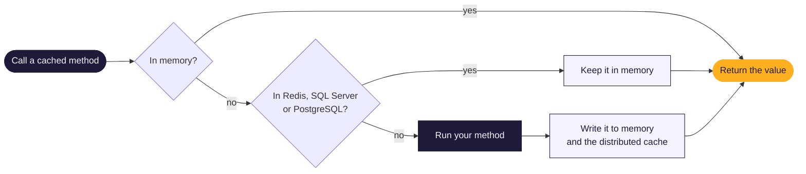
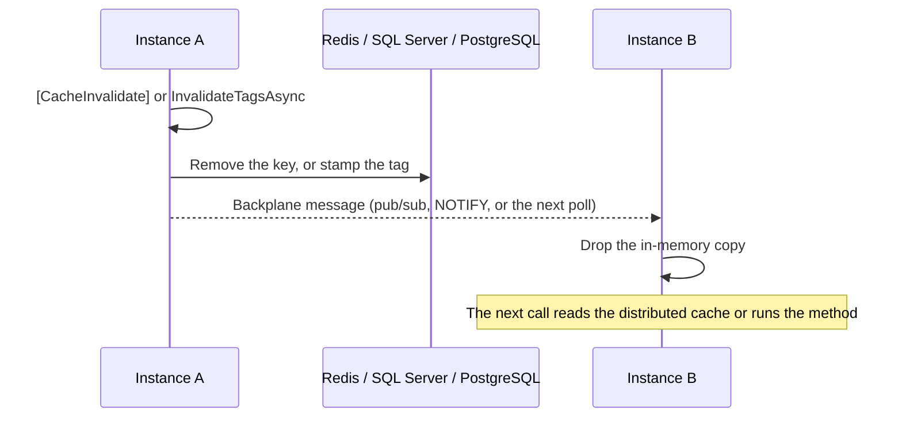

[← MethodCache documentation](../README.md)

# Distributed cache

By default each application instance has its own in-memory cache. Add a distributed cache to share results between
instances and keep them across restarts:

<!-- snippet: distributed-redis -->
```cs
builder.Services.AddMethodCache(mc => mc.UseRedis("localhost:6379"));   // MethodCache.Redis
```
<!-- endSnippet -->

<!-- snippet: distributed-sqlserver -->
```cs
builder.Services.AddMethodCache(mc => mc.UseSqlServer(connectionString));   // MethodCache.SqlServer
```
<!-- endSnippet -->

<!-- snippet: distributed-postgresql -->
```cs
builder.Services.AddMethodCache(mc => mc.UsePostgreSql(connectionString));   // MethodCache.PostgreSql
```
<!-- endSnippet -->

The [web demo](../../samples/MethodCache.WebDemo/) runs two instances that share Redis, including what happens when
Redis goes down.

## How it works





- Results live in memory and in the distributed cache. An in-memory miss reads the distributed cache before
  running your method, and a new result is written to both.
- Invalidating a key removes it from the distributed cache. Invalidating a tag records when it happened, so older
  entries with that tag read as misses. A backplane tells every other instance to drop its in-memory copy: at once
  with Redis pub/sub and PostgreSQL `NOTIFY`, or on their next poll (every second by default) with SQL Server.
- Redis, Microsoft SQL Server and PostgreSQL are supported. Other stores are not; the storage interfaces are
  internal. Use one of them: calling more than one of `UseRedis`, `UseSqlServer` and `UsePostgreSql` throws.
  `Distributed(...)` and `UseMessagePack()` without one log a warning at startup, since they have nothing to apply to.
- `[Cache]` methods and `GetOrCreateAsync` need no changes. Synchronous `[Cache]` methods use only the memory cache,
  so they never wait on the network; a synchronous `[CacheInvalidate]` reaches the other instances in the background.
- MethodCache keeps its own distributed cache and connection, so your application's `IDistributedCache` is left alone
  and is never used as a fallback.

> [!NOTE]
> Instances on different 1.x versions can share a cache and backplane, so you can upgrade them one at a time: every
> 1.x version reads the others' invalidations, and an entry in a format an instance doesn't read is a miss for it. A
> backplane message an instance can't read clears its memory cache, with one warning.

## When the distributed cache is down

Calls keep working from memory and your methods; the distributed cache never fails or stalls a call. Each call to it
is capped at `OperationTimeout` (one second), a circuit breaker skips it until it is back, and invalidations are queued and retried
instead of throwing. Until they are stored, the instance doesn't read entries from it, so an invalidated value can't
come back. The [health check](monitoring.md#health-check) reports Degraded while this lasts.

Queued invalidations are stored a batch at a time once the cache answers, so a long outage's backlog drains at the
pace the cache can take. More than 10,000 are replaced by one clear of the distributed cache (logged as a warning),
and so is an invalidation the cache keeps refusing while it answers everything else, so neither holds up the rest.
The queue lives in memory: when the instance shuts down, it waits for writes still running, then tries once more to store
what is queued, each step (stamp, removal, publish) capped by `OperationTimeout`, and logs a warning with the number it had to drop. Other instances can read those invalidated
values from the distributed cache until they expire.

A value set directly while the distributed cache is down stays in that instance's memory, and the value it replaced is
removed from the distributed cache and the other instances once it is back. An entry that comes back damaged (cut
short, or unreadable by the serializer) is a miss: your method runs and its result replaces the entry.

The timeout caps each call to the distributed cache, not a whole cache miss. A cache that stops answering costs a miss
one timeout, after which the circuit breaker skips it. One that answers just within the timeout costs a miss up to
three: reading the entry, writing your method's result and checking that no removal raced the write (and a fourth for
the backplane message).

## Options

`DistributedCacheOptions` apply to Redis, SQL Server and PostgreSQL alike:

<!-- snippet: distributed-outage-options -->
```cs
builder.Services.AddMethodCache(mc => mc.Distributed(options =>
{
    options.OperationTimeout = TimeSpan.FromMilliseconds(500);
    options.CircuitBreakerDuration = TimeSpan.FromSeconds(30);
}));
```
<!-- endSnippet -->

| Option | Default | |
|---|---|---|
| `OperationTimeout` | 1 second | The longest one call to the distributed cache may take. A slower call is abandoned and counts as a failure, except a write (see [What other instances see](#what-other-instances-see)) |
| `CircuitBreakerDuration` | 10 seconds | How long the distributed cache is skipped after a failure or timeout. Invalidations it didn't accept are retried at this interval |
| `ClockSkewTolerance` | 2 seconds | How far apart your servers' clocks may be. A tag invalidation also applies to entries created up to this long after it. One stamped further ahead of an instance's clock (by a server whose clock runs fast) counts from when that instance first read it, until its clock reaches the stamp |
| `TagCheckInterval` | 1 second | How long an instance trusts the invalidation time it last read for a tag. Without a backplane, an entry read from the distributed cache can outlive a tag invalidation made on another instance by up to this long |
| `TagRetention` | 1 day | How long tag invalidations are kept. An entry stays in the distributed cache at most `TagRetention - ClockSkewTolerance` from when your method started loading it (less if its own duration is shorter); a load that takes longer is kept only in that instance's memory. Both values are truncated to whole milliseconds, and `TagRetention` must exceed `ClockSkewTolerance` by at least one millisecond, or startup fails; with SQL Server it must also end before 9999-12-31 |
| `KeyPrefix` | `methodcache:` | The prefix of everything MethodCache stores and of its backplane messages. Applications that share a store share their entries and invalidations under one prefix; give an application its own to keep them apart ([below](#several-applications-on-one-store)). It can't change while the app runs |
| `StoreValues` | `true` | Store values in the distributed cache. `false` keeps every value in memory and uses the distributed cache for invalidations only ([Invalidations only](#invalidations-only)) |
| `VerifyRoundTrip` | `true` | Read each value back before sharing it, and keep values that don't come back the same in memory only ([Serialization](#serialization)) |
| `SerializerVersion` | `1` | Raise it when you change serializer settings, so values written with the old settings are not read |

## Several applications on one store

Applications that use one Redis or database share everything under the same `KeyPrefix`: entries, tags and
invalidations. That is how a worker invalidates what an API cached. A different prefix keeps two applications apart in
both ways, so neither sees the other's entries nor its invalidations:

```cs
builder.Services.AddMethodCache(mc => mc.UseRedis("localhost:6379").Distributed(o => o.KeyPrefix = "billing:"));
```

Under one prefix, `[Cache]` methods never share an entry by mistake, since each key holds the method's assembly,
interface and name. A key you pass to `ICacheManager` is used as it is, without a type or application, so
`GetOrCreateAsync("order:42", ...)` in two applications is one entry. Cache the same type under such a key everywhere,
or start it with the application's name, such as `billing:order:42` ([Manual caching](manual-caching.md#keys)).

## Invalidations only

When each process should keep its own values, and only needs to hear about invalidations (a worker that changes data
an API caches, say), set `StoreValues = false` in every process. Values stay in each process's memory, those of cached
methods and of [manual calls](manual-caching.md) alike, and every invalidation still reaches the other processes:

<!-- snippet: distributed-invalidations-only -->
```cs
builder.Services.AddMethodCache(mc => mc
    .UsePostgreSql(connectionString)
    .Distributed(o => o.StoreValues = false));   // values stay in memory; invalidations reach every process
```
<!-- endSnippet -->

Invalidations are still stored in the database, so it needs the same tables as a full distributed cache, but no
values are written there, whatever a method or call sets. Each process then loads its own values, so with ten
instances a key is loaded ten times, and a new instance starts with an empty cache. Responses cached by
[HTTP caching](http-caching.md) are still stored in the distributed cache.

To keep only some methods in memory, use `[Cache(Distributed = false)]`, a group or `WithDistributed(false)` instead
([Configuration](configuration.md)). `Defaults(o => o.WithDistributed(false))` applies to cached methods only, so a
manual call would still store its value.

### A worker and an API

A common case: a worker writes data with EF Core, and an API caches reads of it. The API caches in its own memory and
marks the tag as invalidated by another process:

<!-- snippet: distributed-worker-api-reads -->
```cs
public interface IFoodCatalog
{
    // The worker writes the catalog; its saves invalidate food-catalog in every process
    [Cache(Duration = "1d", Tags = ["food-catalog"], InvalidatedElsewhere = ["food-catalog"])]
    Task<IReadOnlyList<FoodDto>> SearchAsync(string text);
}
```
<!-- endSnippet -->

<!-- snippet: distributed-worker-api-api -->
```cs
// The API caches reads of the catalog in its own memory
builder.Services.AddDbContext<FoodDb>(o => o.UseNpgsql(connectionString));
builder.Services.AddScoped<IFoodCatalog, FoodCatalog>();
builder.Services.AddMethodCache(mc => mc
    .UsePostgreSql(connectionString)
    .Distributed(o => o.StoreValues = false));
```
<!-- endSnippet -->

The worker caches nothing. With [MethodCache.EntityFrameworkCore](entity-framework-core.md), its `SaveChanges`
invalidates the tags its mapping names, and the invalidation reaches the API through PostgreSQL:

<!-- snippet: distributed-worker-api-worker -->
```cs
// The worker caches nothing: its saves invalidate the tags the mapping names, in every process
builder.Services.AddDbContext<FoodDb>(o => o.UseNpgsql(connectionString));
builder.Services.AddMethodCache(mc => mc
    .UsePostgreSql(connectionString)
    .Distributed(o => o.StoreValues = false)
    .UseEntityFrameworkCore<FoodDb>(ef => ef.Entity<Food>("food-catalog")));
```
<!-- endSnippet -->

The API reloads the catalog on its next read after the worker's save commits, usually within milliseconds. Writes
the change tracker doesn't see, such as `ExecuteUpdate`, need their tags invalidated by hand
([Writes the change tracker doesn't see](entity-framework-core.md#writes-the-change-tracker-doesnt-see)).

Both processes use the same four tables. When a login may not create tables, such as an API that connects as a role
other than the owner because the database uses row-level security, create them once with the package's script and
grant that login `SELECT, INSERT, UPDATE, DELETE` on them
([Tables](../../src/MethodCache.PostgreSql/README.md#tables)).

`TagCoverage` ([Testing](testing.md#every-tag-has-an-invalidation)) counts `food-catalog` as invalidated only when the
API's test project references the worker project, since the worker is where the invalidation is.

## What other instances see

- An invalidation reaches another instance when the backplane delivers it, usually within milliseconds; until then
  that instance serves its in-memory copy. Instances without a copy read the distributed cache, which is already
  right. When an instance loses its backplane connection:
  - With SQL Server and PostgreSQL, invalidations are rows in a table, so the instance reads the ones it missed when
    it reconnects. An instance that couldn't read the table for half of `BackplaneRetention` may have missed some, so
    it clears its whole in-memory cache.
  - With Redis, a message reaches only the instances connected when it is sent, so the instance clears its whole
    in-memory cache when its connection comes back.
  - With `EnableBackplane = false`, no instance hears of another's invalidations: each serves its in-memory copy until
    it expires.
- Messages carry no values, so a late, repeated or reordered message only makes an instance read the distributed cache
  again.
- An invalidation the distributed cache didn't accept is retried every `CircuitBreakerDuration`. Until the retry
  succeeds, other instances can serve the old value; the instance that invalidated never does.
- A write that timed out (a large value, say) doesn't open the circuit breaker, since the cache may answer everything
  else: the instance logs a warning and keeps using it. Such a write may still land later, because a distributed cache
  has no compare-and-set, so its key is removed again after `CircuitBreakerDuration` (as after a write that failed,
  once the cache answers). Further timed-out writes of the key push that one removal back, and an instance that shuts
  down first removes the key while it shuts down. Until then the late value can replace a newer one, and a write that
  lands after that removal stays until it expires.
- Entries carry no checksum: damage that still reads as a valid value is served.

## Serialization

Values are written as JSON with System.Text.Json, public fields included, so records, value tuples and structs are
shared as they are. A `Dog` where `Animal` is declared comes back as a `Dog` too ([Derived types](#derived-types)).
Each value is read back once before it is shared. A value that doesn't come back the same, such as a class with private
setters, `object`, or a dictionary made with its own comparer, stays in that instance's memory only, with one warning
that names the method and the type. Register your own `JsonSerializerOptions` or `JsonSerializerContext` with `UseJson`
to share it (`[JsonInclude]` for private setters).
[Distributed cache reference](../reference/distributed.md#serialization) has the exact rules.

The `MethodCache.Serialization.MessagePack` package makes values smaller and faster to read:

<!-- snippet: distributed-messagepack -->
```cs
builder.Services.AddMethodCache(mc => mc
    .UseRedis("localhost:6379")
    .UseMessagePack());   // MethodCache.Serialization.MessagePack
```
<!-- endSnippet -->

Entries written in the other format read as misses and are replaced, so switching needs no flush. See the
[MessagePack package guide](../../src/MethodCache.Serialization.MessagePack/README.md). Under Native AOT, register your
`JsonSerializerContext` ([Native AOT](native-aot.md)).

## Derived types

A cached result that declares a base type can hold a derived one: a `Dog` in a `List<Animal>`, in an `Animal`
property, or returned by a method declared to return `Animal`. MethodCache's generator finds the classes that derive
from such a type or implement such an interface, and names them to MethodCache's JSON and MessagePack serializers, so a
`Dog` comes back from the distributed cache as a `Dog`. It finds them in the project with the cached interface, in the
declared type's own assembly and the assemblies built on it, and in projects that reference the one with the cached
interface. Your application's own JSON doesn't change: `JsonSerializer.Serialize<Animal>(dog)` still writes an
`Animal`. The log at startup lists the derived types the distributed cache restores.

- A base type with `[JsonDerivedType]` or `[JsonPolymorphic]`, or `[Union]` with MessagePack, keeps its own settings.
- A derived type the generated code can't name, because it is private, file-local, generic or not public in another
  assembly, gets [MC0039](../user-guide/DIAGNOSTICS.md#mc0039) at build time. A value holding one stays in memory only.
- Under Native AOT, the `JsonSerializerContext` you pass to `UseJson` needs `[JsonSerializable(typeof(Dog))]` as well.
  [MC0040](../user-guide/DIAGNOSTICS.md#mc0040) names a derived type it lacks, and its code fix adds it. At startup,
  MethodCache also logs a warning naming the derived types the context has no contract for.
- EF Core entities with lazy-loading proxies come back as plain entities without their navigations
  ([MC0041](../user-guide/DIAGNOSTICS.md#mc0041)). Cache a projection such as a record instead.

## Results that don't change

The memory cache keeps the instance your method returned and hands that same instance to every later caller on the
instance. The distributed cache keeps a serialized copy. Code that changes a result, such as `orders.Add(draft)` or
`order.Status = Shown`, changes what later callers on this instance get, while the other instances still read the copy
without the change. Instances then give different answers until the entry expires.

- Return types that can't be changed, so the compiler stops such code: records with `init` properties, and
  `IReadOnlyList<T>` or `IReadOnlyDictionary<TKey, TValue>` for collections.
- When a caller needs to change a result, change a copy: `orders.ToList()`, `new List<Order>(orders)`, or
  `order with { Status = OrderStatus.Shown }`. A list copy holds the same objects, so copy an object before setting
  its properties.
- [MC0043](../user-guide/DIAGNOSTICS.md#mc0043) reports code that changes a cached result while you build. Your own
  methods that change an object, such as `order.Close()`, aren't seen by the build. In Development, MethodCache also
  writes the values it keeps in memory again every two seconds, compares them with what it stored, and logs one warning
  per method whose value has changed. That check runs only when `IHostEnvironment` says Development, and never when a
  call is answered from memory.
- Keep all state in what the serializer writes: data only in private fields is written as `{}`
  ([MC0042](../user-guide/DIAGNOSTICS.md#mc0042)).
- An object referenced twice in a result comes back as two copies, and a `DateTime` of kind `Local` shows another
  clock time on a server in another time zone. Use `DateTimeOffset` or UTC times.

## Keep invalidations from being evicted

> [!WARNING]
> Tag, clear and key-removal stamps are ordinary expiring keys next to the entries they invalidate. A store that evicts a
> stamp under memory pressure while an entry it invalidated stays makes that entry valid again, on every instance, until
> it expires. Runtime override records are stored the same way, and an evicted one no longer reaches instances that
> start. Give the store room, and don't let it evict MethodCache's keys: for Redis, use `maxmemory-policy
> noeviction` (or a Redis of its own). Every MethodCache key has a time to live, so the `volatile-*` policies can evict
> them as well as the `allkeys-*` ones. With `noeviction`, a full Redis refuses writes instead: MethodCache then treats it
> as down and answers from memory. SQL Server and PostgreSQL remove rows only once they expired.

## Changing result types and upgrading

- When a cached result's shape changes, such as a renamed property, another property type or renumbered enum members,
  the new build reads entries of its own. MethodCache's generator computes a fingerprint of what the serializer writes
  for each cached method's result, including the derived types registered for it, and keeps entries of another shape
  apart. During a rolling deploy each build reads its own entries, and invalidations by key and by tag reach both.
- Raise the method's `Version` for a change the build can't see: what a value means changes while its shape doesn't,
  a `JsonConverter` writes it differently, or a derived type in a project that references the cached interface's
  project changes. Raise `SerializerVersion` when you change serializer settings.
- Instances on different 1.x versions can share a store and backplane, so a rolling upgrade works. When a release
  writes some keys differently, its CHANGELOG section says so under "Upgrading". During the rollout, instances on the
  old and the new version then miss each other's entries for those methods: each loads once and caches under its own
  key. An invalidation by tag reaches both. An invalidation by key, such as `IMethodCacheKeys.For(...)`, reaches only
  the entry written by the version that sent it, so the other version's entry stays until it expires. Keep the same
  `KeyPrefix` during the rollout, since a different one also keeps the two versions' invalidations apart.
- SQL Server and PostgreSQL create their tables on first use. With an existing SQL Server invalidations table from
  before 1.0, or a login that may not create tables, see the
  [SQL Server](../../src/MethodCache.SqlServer/README.md) and [PostgreSQL](../../src/MethodCache.PostgreSql/README.md) guides.

## Limits

- Invalidation matches exact keys and tags; common tags provide group invalidation.
- [Fail-safe](fail-safe.md) values live in each instance's memory. [Runtime overrides](configuration.md#runtime-overrides)
  apply on every instance with a backplane, and only on their own instance without one.

## Package guides

The [Redis](../../src/MethodCache.Redis/README.md), [SQL Server](../../src/MethodCache.SqlServer/README.md) and
[PostgreSQL](../../src/MethodCache.PostgreSql/README.md) READMEs cover their options, shared connections, table creation,
outage settings and how each stores keys and invalidations. The PostgreSQL guide compares all three; the SQL Server
guide has the schema migration for an existing invalidations table. [Benchmarks](../benchmarks.md#distributed-cache-providers)
measures them side by side. The exact guarantees, such as what a cancelled call leaves behind and how each
backplane recovers, are in the [distributed cache reference](../reference/distributed.md).
