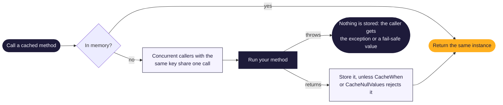

[← MethodCache documentation](../README.md)

# Memory cache

The in-memory cache uses W-TinyLFU eviction: when it is full, it keeps the entries that are read often and
evicts the rest, so a burst of one-off reads doesn't push out your hot data. Configure it with
`MethodCacheMemoryOptions`:

<!-- snippet: memory-options -->
```cs
builder.Services.AddMethodCache(cache => cache.Defaults(o => o.WithDuration(TimeSpan.FromMinutes(10))));
builder.Services.Configure<MethodCacheMemoryOptions>(o =>
{
    o.MaxItems = 50_000;                              // default 10,000
    o.JitterMaxDuration = TimeSpan.FromSeconds(30);   // spread out entries created together
    o.CacheNullValues = false;                        // a null result means "try again next time"
});
```
<!-- endSnippet -->

| Option | Default | What it does |
|--------|---------|--------------|
| `MaxItems` | 10,000 | The most entries kept |
| `SizeLimit` | 1000 MB | The most total weight kept; used only with a `Weigher` |
| `Weigher` | none | Returns an entry's cost, for example its size in bytes |
| `MaxExpiration` | 7 days | No entry lives longer, whatever its duration |
| `JitterMaxDuration` | zero | Adds a random extra lifetime up to this value, so entries created together don't expire together |
| `CacheNullValues` | `true` | Caches `null` results like any other value |

Method defaults are set with `Defaults.WithDuration`; unset defaults use five minutes. Cleanup, statistics and
the generated fast path are always enabled. `MaxHttpBytes` (32 MiB by default) is reserved for the separate HTTP store in design PR 6;
it does not yet limit the current HTTP storage path.

## How a call is answered



## Bounding by size

Object sizes can't be measured reliably at runtime, so to bound the cache by memory you say what an entry costs:

<!-- snippet: memory-weigher -->
```cs
builder.Services.Configure<MethodCacheMemoryOptions>(o =>
{
    o.SizeLimit = 256 * 1024 * 1024;   // bound the cache by size instead of by count
    o.Weigher = (key, value) => value is string s ? s.Length * 2 : 64;
});
```
<!-- endSnippet -->

The weigher must be fast, thread-safe and return a non-negative value. Without one, `SizeLimit` is ignored.

## Memory statistics

`GetStatsAsync().TotalWeight` reports the resident method weight in the configured weigher's units. Without a
weigher, every method entry weighs one; a large returned object does not turn this field into bytes.
`LocalMethodEntries` reports the actual local entry count. Statistics never serialize results or inspect user
properties, and there are no sampling/accurate-estimation modes. HTTP entries and bytes use separate fields and budgets.

## How strict the bound is

Cache hits never wait for eviction. It runs in batches off the read path, so a new entry is stored at once and counted
against `MaxItems` (or `SizeLimit`) when the next batch applies it. Under any load:

- The counted size or weight is never more than one entry over the bound.
- When writers get ahead of eviction, they wait for it and help with it, so at most `16 × processor count` (at least
  64) inserts, plus two per writing thread, are stored but not yet counted.

Moments after the writes stop, the cache is back within the bound.

## Null values

`null` results are cached by default, so a method that returns `null` isn't run again on every call. Set
`CacheNullValues = false` when `null` means "not there yet" and the next call should try again, or use
[`CacheWhen`](conditional-caching.md) for one method.

## Cached objects are shared

> [!WARNING]
> The cache stores the object your method returned and hands the same instance to every caller. Don't change a cached
> object; return immutable types such as records, or copies.

Weighted capacity accounting remains nonnegative even for valid weights near `long.MaxValue`. Before an addition could overflow, the engine evicts existing weight; normal capacity/admission behavior is unchanged below that arithmetic limit.

Dictionary hashes are process-local implementation metadata. Canonical key text, L2 identities, administration and
invalidation remain stable across processes and restarts; the lookup hash is never stored or transmitted.
